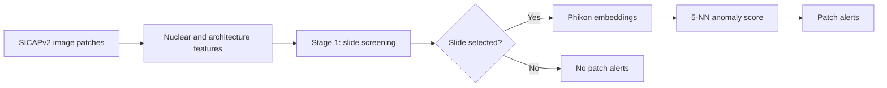
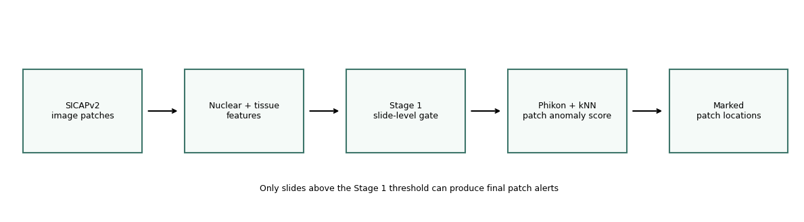
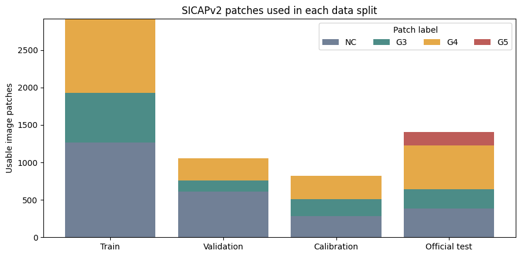
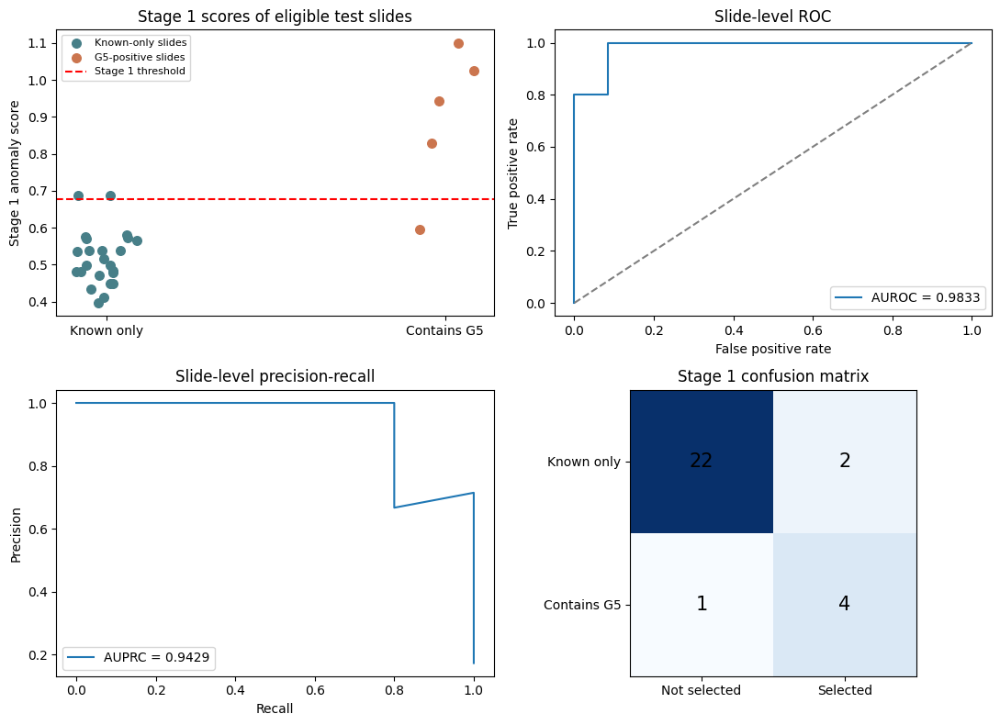
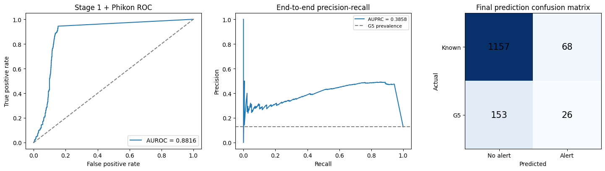
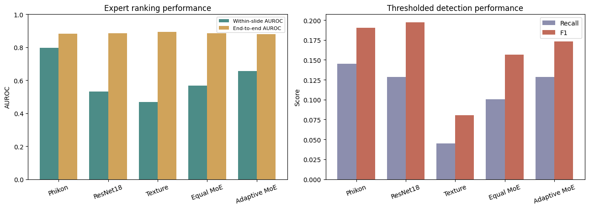
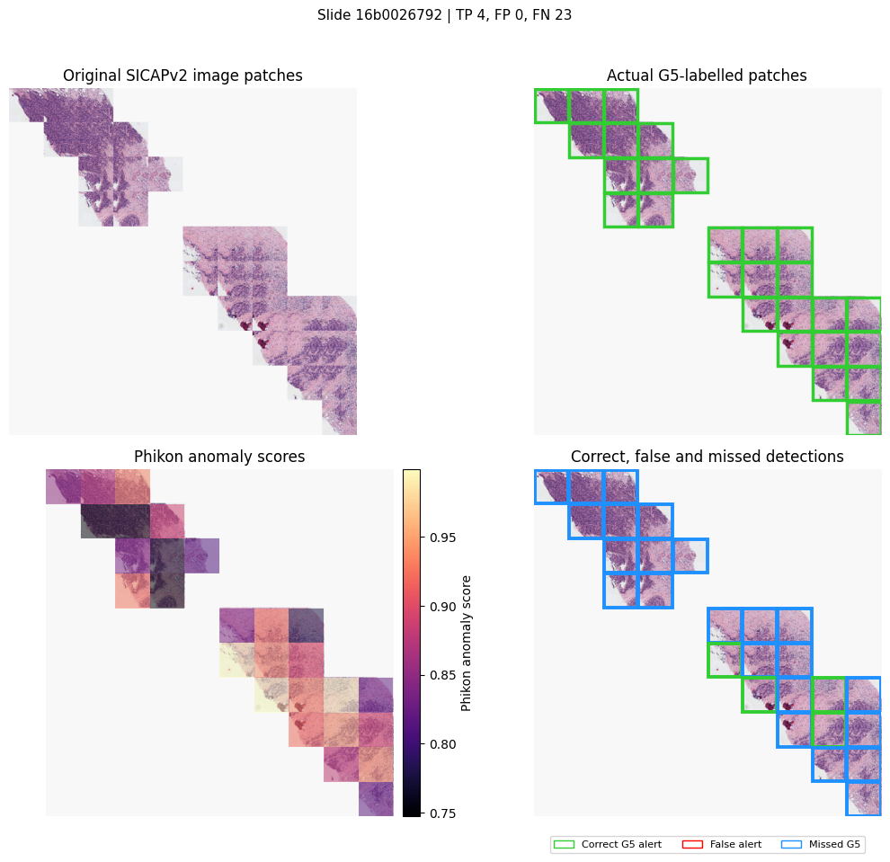

# IDSE: Prostate Tissue Anomaly Detection

This project uses SICAPv2 prostate histology patches to test a two-stage method for detecting unfamiliar tissue patterns. NC, G3 and G4 are treated as known classes. G5 is held out for evaluation.

## Method

Stage 1 screens slides using measurements of nuclei and tissue structure. We calculate class-wise Mahalanobis distances, keep the closest known-class distance for each feature group, and combine the nuclear and architecture scores. Patch scores are averaged to obtain a slide score.

Stage 2 uses frozen Phikon embeddings. Each patch is compared with five nearest neighbours in separate NC, G3 and G4 reference sets using cosine distance. A final patch alert requires both a positive Stage 1 slide decision and a Phikon score above the calibration threshold.

## Dataset

We used [SICAPv2 on Kaggle](https://www.kaggle.com/datasets/duong1589/sicapv2). The original dataset publication is also available on [Mendeley Data](https://data.mendeley.com/datasets/9xxm58dvs3/2).

The experiment uses image files and the accompanying `Train.xlsx` and `Test.xlsx` labels. Patches from the same slide are kept together when splitting known-grade training, validation and calibration data. G5 is not used to fit the reference models.

## Results

The recorded full experiment gave these results:

| Evaluation | Result |
| --- | ---: |
| Stage 1 slide AUROC (29 eligible slides) | 0.9833 |
| Stage 1 slide accuracy | 89.66% |
| Phikon within-slide AUROC (six mixed slides) | 0.7961 |
| End-to-end Stage 1 + Phikon AUROC (1,404 patches) | 0.8816 |
| G5 patches flagged at the final threshold | 26 / 179 |

We compared Phikon with ResNet18, handcrafted texture features, equal-weight score fusion and an adaptive router. Phikon had the highest within-slide AUROC and detected the most G5 patches at the recorded thresholds, so we used it for the final patch detector.

## Slide visualization

The notebook places source patches on a grid using their recorded slide coordinates. The overlays show patch scores and detections, rather than pixel-level tissue boundaries.

## Running the code

Open `notebooks/IDSE.ipynb` in Kaggle, attach the [SICAPv2 dataset](https://www.kaggle.com/datasets/duong1589/sicapv2), and enable a GPU. The notebook expects the image directory and the labels in `partition/Test/Train.xlsx` and `partition/Test/Test.xlsx`. Run the cells in order. Access to the pretrained `owkin/phikon` and ResNet18 weights is required.

The figures and metrics in `results/` were saved from the original full experiment. They are included for reference; the simplified notebook has not been independently verified to reproduce every recorded number in a fresh environment.

## Files

- `notebooks/IDSE.ipynb`: main notebook
- `report/IDSE_report.pdf`: project report
- `results/figures/`: plots and patch visualizations from the full experiment
- `results/recorded_metrics.csv`: recorded evaluation metrics
- `requirements.txt`: Python dependencies

This is a coursework experiment on histology image analysis, not a clinically validated diagnostic system.
